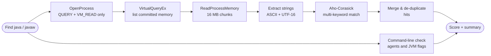

<div align="center">

```
   ██████╗ ███╗   ██╗██╗   ██╗██╗  ██╗
  ██╔═══██╗████╗  ██║╚██╗ ██╔╝╚██╗██╔╝
  ██║   ██║██╔██╗ ██║ ╚████╔╝  ╚███╔╝
  ██║   ██║██║╚██╗██║  ╚██╔╝   ██╔██╗
  ╚██████╔╝██║ ╚████║   ██║   ██╔╝ ██╗
   ╚═════╝ ╚═╝  ╚═══╝   ╚═╝   ╚═╝  ╚═╝
        M E M O R Y   S T R I N G   A N A L Y Z E R
```

### One command. Live `javaw` memory. Cheat-string indicators in seconds.

[](#-requirements)
[](#-requirements)
[](#-safety--privacy)
[](#-detection-database)
[](#)

**[⚡ Quick Start](#-quick-start)** •
**[🎛 Options](#-options)** •
**[🖥 Preview](#-preview)** •
**[🧠 How it works](#-how-it-works)** •
**[🗂 Database](#-detection-database)** •
**[🛡 Safety](#-safety--privacy)** •
**[❓ FAQ](#-faq--troubleshooting)**

</div>

---

## 🔎 What is this?

**Onyx Strings** is a Minecraft screenshare (SS) helper. It opens the running `javaw.exe` / `java.exe`
process **read-only**, pulls every readable **ASCII and UTF-16 string** out of its memory (like the
*Strings* tab in Process Hacker / System Informer), and matches them against a built-in database of
cheat clients, modules, packages, and loaders.

> 🧩 It is a **string analyzer**, not a mod/JAR analyzer. It looks at what is actually loaded in memory
> right now, including things that were deleted from disk after launch.

<table>
<tr>
<td width="33%" valign="top">

### ⚡ Fast
Native C# scanner with a single-pass multi-keyword matcher. Gigabytes of memory in seconds to a couple of minutes.

</td>
<td width="33%" valign="top">

### 🔍 Evidence-based
Every finding comes with a count and (with `-Detail`) the surrounding string, so you can verify instead of guess.

</td>
<td width="33%" valign="top">

### 🛡 Read-only
No injection, no writes, no network calls. See [Safety & Privacy](#-safety--privacy).

</td>
</tr>
</table>

---

## ⚡ Quick Start

> Start Minecraft and **get in-game first**, then run one of the commands below.

<details open>
<summary><b>▶ Option 1 — Run directly (recommended)</b> &nbsp;<sub>click to collapse</sub></summary>

<br>

Paste into **CMD**, **PowerShell** or **Windows Terminal**:

```powershell
powershell -ExecutionPolicy Bypass -Command "& ([scriptblock]::Create((irm 'https://raw.githubusercontent.com/v1shal-tools/onyx-strings-analyzer/main/Onyx_Strings.ps1').TrimStart([char]0xFEFF)))"
```

Nothing is installed and nothing is saved to disk. The script runs in memory.

</details>

<details>
<summary><b>▶ Option 2 — Run with options</b> &nbsp;<sub>click to expand</sub></summary>

<br>

Append any [option](#-options) after the closing parenthesis, for example verbose evidence:

```powershell
powershell -ExecutionPolicy Bypass -Command "& ([scriptblock]::Create((irm 'https://raw.githubusercontent.com/v1shal-tools/onyx-strings-analyzer/main/Onyx_Strings.ps1').TrimStart([char]0xFEFF))) -Detail -Samples 3"
```

</details>

<details>
<summary><b>▶ Option 3 — Clone and run locally</b> &nbsp;<sub>click to expand</sub></summary>

<br>

```bash
git clone https://github.com/v1shal-tools/onyx-strings-analyzer.git
cd onyx-strings-analyzer
powershell -ExecutionPolicy Bypass -File .\Onyx_Strings.ps1
```

Prefer a ZIP? Use **Code → Download ZIP** on the repo page, extract, and run the last command inside the folder.

</details>

<details>
<summary><b>▶ Option 4 — Run elevated (Administrator)</b> &nbsp;<sub>click to expand</sub></summary>

<br>

If you see `OpenProcess failed`, open **Windows Terminal / PowerShell as Administrator** and run Option 1 again.
Elevation is only needed when Windows refuses read access to the process.

</details>

### 🚦 3 steps

| # | Step | |
|:-:|------|---|
| **1** | Launch Minecraft and join a world/server | 🎮 |
| **2** | Paste the command above | 📋 |
| **3** | Read the score box, then check the HIGH / MED lines | 🔬 |

Press **`R`** to rescan or **`Q`** to quit when the scan finishes.

---

## 🎛 Options

| Option | Default | What it does |
|--------|:-------:|--------------|
| `-Detail` | off | Show evidence strings under every HIGH / MED finding |
| `-Samples <n>` | `2` | How many evidence strings per finding (with `-Detail`) |
| `-ProcessId <pid>` | auto | Scan a specific Java process instead of auto-picking |
| `-MinLength <n>` | `5` | Shortest string length to extract |
| `-KeywordFile <path>` | none | Add your own keywords (see [custom keywords](#-add-your-own-keywords)) |
| `-DumpStrings` | off | Save **all** extracted strings to `%TEMP%` for manual searching |
| `-NoPause` | off | Run once and exit (no menu, no prompts) |

---

## 🖥 Preview

<details open>
<summary><b>Example output</b> &nbsp;<sub>(illustrative, not a real scan)</sub></summary>

```text
        M E M O R Y   S T R I N G   A N A L Y Z E R
        v0.2.0  •  read-only  •  indicators, not verdicts
──────────────────────────────────────────────────────────────────────────────
  javaw.exe  PID 9400  •  1.24 GB  •  up 2h 38m  •  fabric-loader-0.19.5-1.21.11
  256 keywords  •  not elevated

╔════════════════════════════════════════════════════════════════════════════╗
║ ██████░░░░░░░░░░░░░░  30/100  GRADE F   RISK CRITICAL                      ║
║ HIGH 4    MED 3    LOW 6                                                   ║
║ 63,143,335 strings  •  2.16 GB  •  27.7s                                   ║
╚════════════════════════════════════════════════════════════════════════════╝

   HIGH   autocrystal            ×14   Combat module
   HIGH   triggerbot             ×15   Combat module
   HIGH   aimassist              ×13   Combat module
   HIGH   examplecheatclient     ×144  Known client
   MED    wtap                   ×16   Combat / utility
   MED    targethud              ×15   Visual / ESP
   MED    selfdestruct           ×1    Combat / utility

   LOW    criticals ×712, refill ×57, fastplace ×8, tracers ×4

  Origin hint  cc/silk (38)
  (package seen in the matching strings; find which jar owns it)

  ✓ JVM: no unrecognized agent or risky flags
━━━━━━━━━━━━━━━━━━━━━━━━━━━━━━━━━━━━━━━━━━━━━━━━━━━━━━━━━━━━━━━━━━━━━━━━━━━━
  Indicators, not proof. Legit mods/anticheat/chat can contain these strings.

  [R] Rescan   [Q] Quit
```

</details>

### 🔬 How to read the result

| Level | Meaning | What to do |
|:-----:|---------|------------|
| 🔴 **HIGH** | Distinctive cheat names (client names, specific modules, client packages) | Verify the owning mod/class right away |
| 🟡 **MED** | Common module names that can also appear in legit tools | Check with `-Detail`; look for several together |
| ⚪ **LOW** | Weak markers (generic words, mixin accessors) | Only matters in combination with HIGH / MED |
| 🧭 **Origin hint** | Package prefix that shows up repeatedly in matching strings | Search your mods for that package to find the owning jar |

> **Tip:** one lone LOW hit means almost nothing. A *cluster* of HIGH hits from the same package is the strong signal.

---

## 🧠 How it works



<details>
<summary><b>🔤 Fullwidth &amp; spaced variants</b></summary>

<br>

Cheats often hide labels as fullwidth Unicode (`ＡｕｔｏＣｒｙｓｔａｌ`) or with spaces (`Auto Crystal`).
Onyx normalizes fullwidth characters to ASCII and ignores case before matching, then merges
spacing variants (`hover totem` / `hovertotem`) into a single finding.

</details>

<details>
<summary><b>🧪 JVM launch checks</b></summary>

<br>

The process command line is checked for external agents and risky flags:

| Flag | Why it matters |
|------|----------------|
| `-javaagent:` | External agent attached to the JVM (known profilers are ignored) |
| `-Xbootclasspath/p:` · `/a:` | Overrides or extends core Java classes |
| `-agentlib:jdwp` | Remote debugging / control channel |
| `-agentpath:` | Native agent loaded outside the Java sandbox |

</details>

---

## 🗂 Detection database

<details>
<summary><b>Click to see the categories</b></summary>

<br>

| Sev | Category | Examples |
|:---:|----------|----------|
| 🔴 3 | **Known client** | well-known cheat client names and domains |
| 🔴 3 | **Client package** | package paths and refmap files used by cheat clients |
| 🔴 3 | **Combat module** | `AutoCrystal`, `AutoAnchor`, `TriggerBot`, `AimAssist`, `AutoTotem`, `AutoPot`, `ShieldBreaker`, `StunSlam`, `PingSpoof` … |
| 🔴 3 | **Credential stealer** | `TokenLogger`, `TokenGrabber`, `SessionStealer` |
| 🟡 2 | **Combat / utility** | `AutoArmor`, `WTap`, `FastXP`, `GrimBypass`, `SelfDestruct`, `jnativehook` … |
| 🟡 2 | **Movement / exploit** | `FlyHack`, `PacketFly`, `Nuker`, `ScaffoldWalk` … |
| 🟡 2 | **Visual / ESP** | `PlayerESP`, `ChestESP`, `OreFinder`, `TargetHUD` … |
| 🟡 2 | **Module setting** | `Silent Rotations`, `Click Simulation`, `Glowstone Delay` … |
| 🟡 2 | **Obfuscator** | `Skidfuscator`, `Paramorphism`, `Qprotect` … |
| ⚪ 1 | **Weak marker** | `Criticals`, `FastPlace`, `Tracers`, mixin accessor names … |

The full, editable list lives at the top of [`Onyx_Strings.ps1`](./Onyx_Strings.ps1) in the `$DefaultKeywords` block.

</details>

### ➕ Add your own keywords

Create a text file, one rule per line: `Severity|Category|word1;word2;word3`

```text
# my-keywords.txt   (3 = HIGH, 2 = MED, 1 = LOW)
3|Custom client|mycheatclient;mycheat.jar
2|Custom module|superreach;megaaura
```

```powershell
.\Onyx_Strings.ps1 -KeywordFile .\my-keywords.txt
```

Matching is case-insensitive. Lines starting with `#` are ignored.

---

## 🛡 Safety & privacy

| | |
|---|---|
| ✅ **Read-only** | Opens the process with `PROCESS_QUERY_INFORMATION` and `PROCESS_VM_READ` only. Never writes to or injects into Minecraft. |
| ✅ **No network** | The script makes no web requests while scanning. (Option 1 downloads the script itself from this repo.) |
| ✅ **No files by default** | Results are shown on screen only. A file is written **only** if you pass `-DumpStrings`. |
| ✅ **Open source** | One readable `.ps1` file. Review it before you run it. |

> ⚠️ **Responsible use.** Only scan a computer with the owner's consent (for example, a player agreeing to a screenshare).
> A match is an **indicator, not proof**. Legit mods, anti-cheat plugins, and even chat text can contain the same words,
> and cheats can hide or encrypt their strings. Always confirm the owning mod or class before drawing conclusions.

---

## 📋 Requirements

- Windows 10 / 11
- **64-bit** Windows PowerShell 5.1+ (the default `powershell.exe` is fine)
- Minecraft running (`javaw.exe` or `java.exe`)
- A terminal with Unicode support. **Windows Terminal** looks best; classic `cmd` works too

---

## ❓ FAQ & Troubleshooting

<details>
<summary><b>"No java/javaw process found"</b></summary>

<br>

Start Minecraft and wait until you are in-game. You can check the process list with:

```powershell
tasklist /FI "IMAGENAME eq javaw.exe"
```

Some launchers use `java.exe`; Onyx checks both.

</details>

<details>
<summary><b>"OpenProcess failed"</b></summary>

<br>

Run the terminal as **Administrator** and try again. Security software can also block memory reads from scripts.

</details>

<details>
<summary><b>"running scripts is disabled" / execution policy errors</b></summary>

<br>

Use the commands above as written. They include `-ExecutionPolicy Bypass` for that single run and change nothing permanently.

</details>

<details>
<summary><b>The download command fails or hangs</b></summary>

<br>

On older Windows builds, force TLS 1.2 first:

```powershell
[Net.ServicePointManager]::SecurityProtocol = [Net.SecurityProtocolType]::Tls12
```

Then run the command again, or use [Option 3](#-quick-start) (clone and run locally).

</details>

<details>
<summary><b>Characters look broken (boxes / question marks)</b></summary>

<br>

Use **Windows Terminal**, or set the console font to one that supports box-drawing characters (for example *Consolas* or *Cascadia Mono*).

</details>

<details>
<summary><b>I got a HIGH hit. Is that person cheating?</b></summary>

<br>

Not automatically. Re-run with `-Detail` and read the evidence strings. Strong signs are *several* HIGH hits from the
*same package*, and an **Origin hint** that points to a jar you can find on disk. Weak signs are single keywords inside
unrelated text (for example, a Windows DLL string that happens to contain a short keyword).

</details>

<details>
<summary><b>Does it scan my mods folder / JAR files?</b></summary>

<br>

No. Onyx Strings only reads **live process memory**. Use it alongside a file/JAR-based mod analyzer for a fuller picture.

</details>

---

<div align="center">

**Made by [v1shal-tools](https://github.com/v1shal-tools)** &nbsp;•&nbsp;
[⭐ Star the repo](https://github.com/v1shal-tools/onyx-strings-analyzer) &nbsp;•&nbsp;
[🐛 Report an issue](https://github.com/v1shal-tools/onyx-strings-analyzer/issues)

<sub>Indicators, not verdicts.</sub>

</div>
